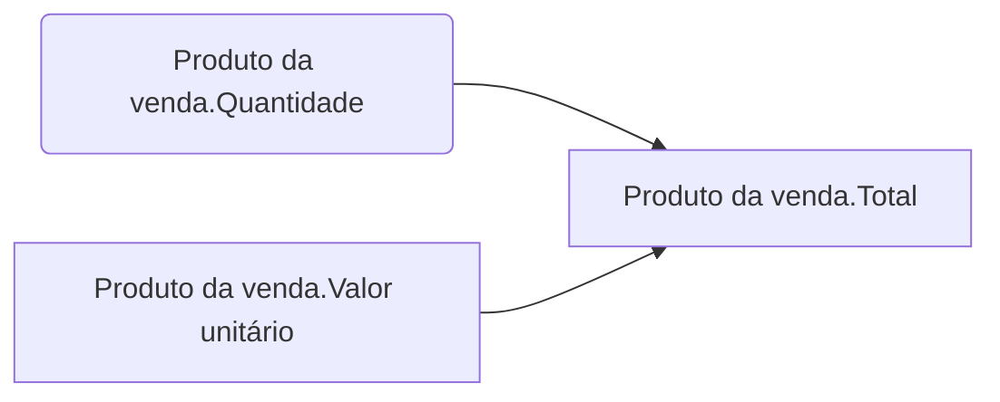

# Indicação de proposta

> **Antes de rodar, leia [o protocolo comum](../_nucleo/protocolo-de-indicacao.md).**
> Ele define o dossiê de entrada, as três fases da consulta ao acervo, o contrato
> de saída (CSV + racional + lacunas) e a disciplina do portão. O que está aqui é
> só o que é desta peça.

## 0. Por onde ela entra, e onde grava

🔴 **Onde ler e onde gravar está no [modo de trabalho](../_nucleo/modo-de-trabalho.md)** — leia-o
antes de começar.
O que é desta peça:

| Esta skill grava, na pasta de entrega | Arquivo |
|---|---|
| a especificação do modelo | `arquivos-de-configuracao/modelos.csv` |
| os campos por modelo | `arquivos-de-configuracao/campos-modelo.csv` |
| a identidade visual do site do cliente | `identidade-visual.json` |
| o layout do modelo, com essa identidade | `modelo-de-proposta.html` |


➜ *Por quê os dois últimos ficam fora da `arquivos-de-configuracao/`:* aquela pasta guarda os sete
CSVs que o portão de coerência lê juntos, e o layout não é linha de ingestão — é o HTML que sobe no
modelo de PVD quando a configuração é aplicada na conta.

## O que esta skill decide

**Como a proposta comercial daquele cliente passa a ser feita dentro do Ploomes.**

A entrada é o material real dele: a proposta que manda hoje, a identidade visual,
a estrutura de produto. A saída é a especificação do modelo — e, no meio, uma
tradução que é onde a skill ganha ou perde: **um PDF corrido virando uma
estrutura de quatro níveis com seções**.

### As três fontes, e o que cada uma responde

| Fonte | Responde |
|---|---|
| **a proposta atual do cliente** (os documentos dele) | o que ele precisa que apareça, e como apresenta |
| **o acervo** de contas implantadas | como isso já foi resolvido em operação parecida |
| **os limites da plataforma** | o que dá para fazer, e o que custa plano acima ou add-on |

Nenhuma sozinha basta. Só o PDF do cliente produz cópia fiel de um processo ruim;
só o acervo produz modelo genérico; só os limites produz "não dá".

---

## Roteiro

### 1. Ler a proposta atual — a ficha

Abra [references/ficha-de-leitura.md](references/ficha-de-leitura.md) e preencha
os sete blocos na ordem. Cada um termina numa decisão, não numa observação:

1. **quantas propostas diferentes existem** — muda estrutura, ou só conteúdo?
2. **onde o documento quebra de página** — seção é quebra de página, sempre
3. **o que aparece uma vez e o que se repete** — resolve o nível de cada campo
4. **como o produto é apresentado** — as colunas, e o teto de itens que elas impõem
5. **de onde vem cada número** — nativo, CPQ, integração ou manual
6. **o que da identidade visual sobrevive** — A4 retrato, sem sumário
7. **o que o cliente ainda não tem** — campos a criar, e as lacunas

A ficha existe porque a tradução tem armadilhas específicas: tratar bloco como
produto, tratar opcional como produto, e descobrir tarde que o número de colunas
da tabela derruba o teto de itens da proposta.

### 2. Extrair a identidade visual do site — o branding do Firecrawl

🔴 **Toda proposta nova passa por aqui.** Rode o `firecrawl_scrape` com `formats: ["branding"]` na
URL do site do cliente — a do contexto do cliente, no [modo de trabalho](../_nucleo/modo-de-trabalho.md). Ele devolve
as cores, a tipografia, o logotipo e o espaçamento que o site usa. Grave o resultado, como veio, em
`identidade-visual.json`, na pasta de entrega. **Custa 1 crédito.**

Depois, monte o `modelo-de-proposta.html`, na mesma pasta: **a estrutura e o conteúdo vêm da
proposta atual** (a ficha do passo 1), **a forma vem do branding**, e **os limites vêm do
Ploomes** — A4 retrato, seção é página nova, sem sumário. ➜ *Por quê:* a proposta é o documento
do CRM que o cliente do cliente vê. Sair do projeto com a proposta dele mais bonita do que entrou,
e com a cara da marca dele, é o primeiro resultado que ele percebe, antes de qualquer indicador.

⚠️ **Sem Firecrawl na máquina**, a identidade sai da própria proposta atual — as cores e o logotipo
que o PDF já usa —, e o racional declara `LACUNA — branding do site não extraído`. ⚠️ **Sem
proposta atual entre os documentos do cliente**, o layout sai do branding, com o acervo quando houver, e o racional declara que não houve proposta de partida.

⛔ **O branding não decide conteúdo:** ele diz como a proposta se parece, nunca o que ela diz. E
⛔ **não prometa no HTML o que o Ploomes não imprime** — paisagem, sumário, numeração automática.

### 3. Consultar o acervo

Aplique as três fases do [protocolo](../_nucleo/protocolo-de-indicacao.md#2-consulta-ao-acervo):
o perfil do cliente, que pesa e marca o que é comparável, a busca e a leitura com higiene. Nesta peça, leia os
documentos `tipo: modelo_documento` e `estrutura_cpq` — e rode o analisador sobre as contas comparáveis.

```bash
python "${CLAUDE_PLUGIN_ROOT}/skills/_nucleo/consultar_acervo.py" \
       --tipo modelo_documento --segmento <segmento> --moc "<moc>" \
       --tipo-venda "<tipo de venda>" --busca "<o que procura>"
```

### 4. Analisar modelos de contas Ploomes

Este é o mesmo script usado no acervo e em qualquer conta existente.

## Separando o que roda do que sobrou

Conta madura acumula modelo. É normal encontrar `Produtos comuns`,
`Produtos comuns - cópia`, `Produtos comuns - Teste`, `NÃO USAR - Produtos comuns`.
Analisar todos gasta tempo e, pior, mistura configuração viva com lixo.

**`DocumentTemplate` não tem flag de ativo.** O sinal é uso: modelo do qual se
gerou PVD recentemente.

```http
GET /Quotes?$apply=groupby((TemplateId),aggregate(Id with countdistinct as Qtd))
User-Key: <key>
```

Para recortar por período, filtre antes:

```http
GET /Quotes?$filter=CreateDate ge 2026-01-01T00:00:00Z
  &$apply=groupby((TemplateId),aggregate(Id with countdistinct as Qtd))
```

Monte o `uso.json` como `{"Nome do modelo": 128}` e passe com `--uso`. Modelo com
zero PVDs no período **não entra na análise** — entra na lista de limpeza.

> `$count=true` aqui não: use `$apply=aggregate`, `/Quotes` é coleção pesada.

---

## Rodar

```bash
python scripts/analisar_proposta.py <pasta-da-conta> \
       --uso uso.json --grafo dependencias.mmd --json analise-da-conta.json
```

---

## Como ler o que sai

### Formato do documento

Por modelo, cada seção com o número de variáveis e o que ela contém:

```
[ATIVO] Produtos comuns  (Proposta, 2 seções)
      · CAPA                     7 variáveis   —
      · Seção 1                 90 variáveis   blocos, produtos, cabeçalho, rodapé
      consultas OData próprias: RootODataQuery, SectionsODataQuery, ProductsODataQuery
```

Três coisas para reparar:

- **Seção nova é página nova.** Uma capa separada custa uma folha, sempre.
- **Blocos, produtos e opcionais só aparecem no corpo** — se aparecerem no
  cabeçalho ou rodapé do relatório, algo está errado na leitura.
- **`consultas OData próprias`** significa que o modelo executa query customizada
  para montar seções, produtos ou peças. É um ponto de acoplamento e de
  fragilidade: mudou o dado, muda a proposta, sem aviso.

### Variáveis

Agrupadas por nível (PVD, Bloco, Produto, Opcional, Vinculada) e por entidade.

A entidade `Vinculada` merece atenção: são campos que vêm de outra entidade por
**field-path**, e a referência mostra o caminho — `[Negócio / Usuário.Nome]` lê o
nome do usuário do negócio. Quebrar esse vínculo quebra a proposta.

Duas coisas a procurar:
- **variável que aparece uma vez só** — candidata a resíduo de cópia
- **mistura de idioma** (`Quote's product` ao lado de `Produto da proposta`) —
  sinal de modelo copiado de outra conta ou de versão antiga

### Memorial de cálculo

```
MEMORIAL DE CÁLCULO — 89 campos calculados
  Onde a conta acontece:
      71  fórmula JavaScript no Ploomes
      17  consulta externa (API/ERP)
       1  referência de campo
```

E a lista das consultas externas com URL e método. **Essa é a resposta à pergunta
"o cálculo é no Ploomes ou na integração"**, e ela costuma surpreender: vale olhar
o host de cada URL antes de concluir. Uma consulta para o domínio da própria
Ploomes é o motor de planilha (Excel/Google Sheets como calculadora), não o ERP do
cliente. Uma consulta para o domínio do cliente é integração de verdade, e vira
dependência de disponibilidade: ERP fora do ar, proposta não fecha.

Mais duas listas:

- **Entradas manuais** — campos que só alimentam e nunca são calculados. É o
  trabalho que sobra para o vendedor.
- **Resultados finais** — campos calculados que ninguém consome depois. Ou
  aparecem no HTML, ou são cálculo órfão que ficou de uma versão anterior.

### O grafo

`--grafo dependencias.mmd` gera Mermaid, que renderiza direto em Markdown:



Três cores: **entrada** (azul, alguém preenche), **calculado** (verde, fórmula no
Ploomes), **externo** (vermelho, sai para uma API).

**As arestas não são inferidas do texto da fórmula.** Saem de
`Fields.FormulaVariables`, onde cada variável declara o campo de origem
(`VariableFieldKey`) e o campo que alimenta (`FieldKey`). É a dependência que a
plataforma declara, não a que o parser adivinhou.

O que o grafo revela e a leitura linha a linha não:

| Padrão no grafo | O que significa |
|---|---|
| cadeia longa até o total | uma entrada errada contamina tudo à frente |
| nó vermelho no meio da cadeia | o total depende de um sistema externo estar de pé |
| nó calculado sem saída | cálculo órfão |
| entrada que alimenta muitos | campo crítico — errar ali erra a proposta inteira |
| dois caminhos até o mesmo total | risco de divergência entre eles |

---

## Limites que a análise precisa respeitar

Estão em [references/vocabulario-proposta.md](references/vocabulario-proposta.md).
Os três que mais mudam conclusão:

**O teto de produtos é fórmula, não número.** 150 produtos se o produto tiver até
4 campos; cada campo a mais tira 8. Um modelo com 12 campos de produto comporta
**86**. Se a operação monta proposta com 100 itens, o modelo já está estourado.

**Só existem três fórmulas nativas** — Total do produto, Total do bloco, Valor do
PVD. Tudo além disso é CPQ, que é outro módulo. Contar quantos cálculos passam
disso é medir quanto da proposta depende do add-on CPQ.

**A tabela de parcelas é fechada.** Não aceita propriedade nova e o cálculo é
sempre Valor ÷ nº de parcelas. Cliente que precisa de forma de pagamento por
parcela precisa de outra estrutura.

---

## Entregar

### A especificação (o que vai para configuração)

Dois CSVs, conferidos pelo portão:

```bash
python scripts/validar_modelos.py modelos.csv campos-modelo.csv
```

`modelos.csv` — tipo, finalidade, visibilidade, seções, parcelas, produtos típicos.
`campos-modelo.csv` — cada campo com seu **nível**, origem (nativo ou novo), se
aparece no HTML e qual cálculo o alimenta.

E o layout, em `modelo-de-proposta.html`, com a identidade de `identidade-visual.json`, os dois na
pasta de entrega (§2 do roteiro). ⚠️ **Todo campo que o HTML mostra tem
linha no `campos-modelo.csv`** — campo desenhado no layout e ausente do CSV não é construído.

O portão checa o que ninguém confere a olho: revisão marcada em Venda (só Proposta
tem), parcelas sem campo de total, e **o teto de produtos**, que é função de
quantos campos o produto tem — 12 campos derrubam o teto para 86 itens.

### O racional (o que vai para quem configura e para o orçamento)

```
PROPOSTA — <cliente>
  Modelos ativos: 3 de 14 (11 são cópias, testes ou marcados como não usar)
  Formato: capa + 1 seção; blocos, produtos e opcionais no corpo; cabeçalho e
    rodapé repetidos por página
  Variáveis: 218 distintas, 340 referências vindas de entidade vinculada
  Cálculo: 71 fórmulas JS no Ploomes, 17 consultas externas
    → as 17 apontam para <host>; confirmar se é motor de planilha ou ERP
  Dependência crítica: <campo> alimenta <N> cálculos
  Órfãos: <N> campos calculados que ninguém consome
  Limpeza sugerida: <lista dos modelos sem uso>
```

## O que NUNCA fazer

- **Entregar a proposta sem passar pelo branding** (§2 do roteiro), havendo Firecrawl na máquina.
- **Copiar o PDF do cliente linha por linha.** O documento atual carrega
  limitação da ferramenta antiga; replicar tudo replica o problema.
- **Prometer layout que o Ploomes não faz** — paisagem, sumário, numeração
  automática de capítulo.
- **Deixar cálculo sem mecanismo declarado.** Cada número do documento precisa
  dizer se é fórmula nativa, CPQ, integração ou digitação.
- **Esconder o custo do CPQ.** Passou das três fórmulas nativas, é o add-on CPQ —
  isso vai para o orçamento, não para a nota de rodapé.
- **Especificar campo de produto sem checar o teto de itens.**
- **Analisar modelo que não roda** sem dizer que ele não roda.
- **Concluir "o cálculo é no ERP"** sem olhar o host da URL.
- **Ignorar as consultas OData próprias** do modelo — são acoplamento invisível.
- **Tratar o grafo como prova de correção.** Ele mostra dependência, não se a
  fórmula está certa.
- **Propor novo modelo** antes de entender o que já roda.

---

## Arquivos

- [scripts/analisar_proposta.py](scripts/analisar_proposta.py) — a análise e o grafo
- [scripts/validar_modelos.py](scripts/validar_modelos.py) — portão para quando a
  indicação de modelo novo entrar em cena
- [references/ficha-de-leitura.md](references/ficha-de-leitura.md) — os sete
  blocos que traduzem o PDF do cliente na estrutura do Ploomes
- [references/vocabulario-proposta.md](references/vocabulario-proposta.md) — os
  quatro tipos, a hierarquia de quatro níveis, os limites e as fórmulas nativas
